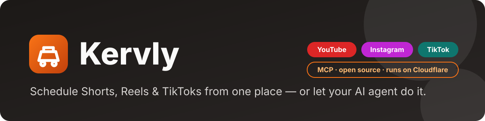
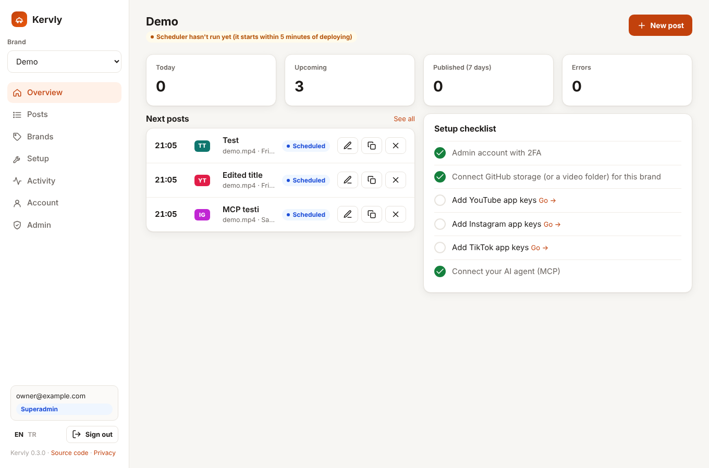
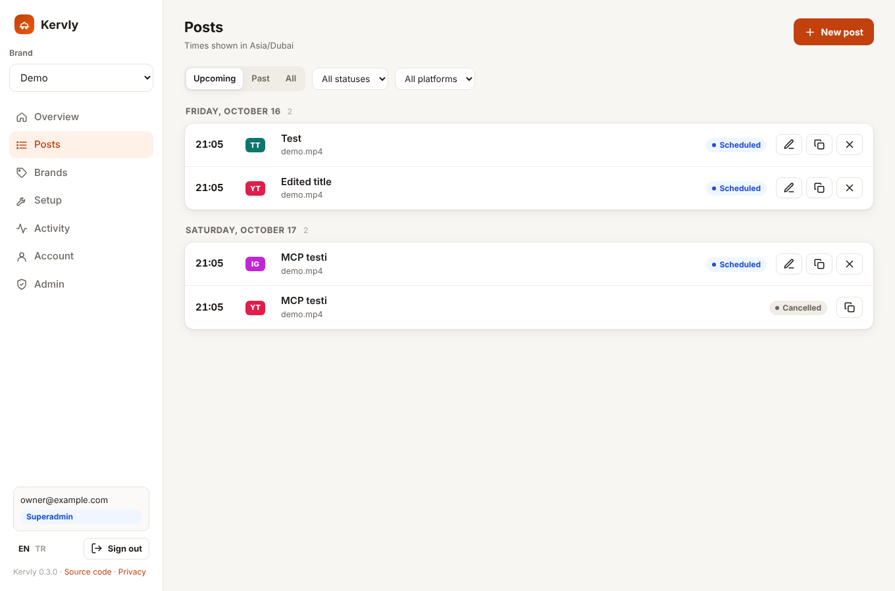
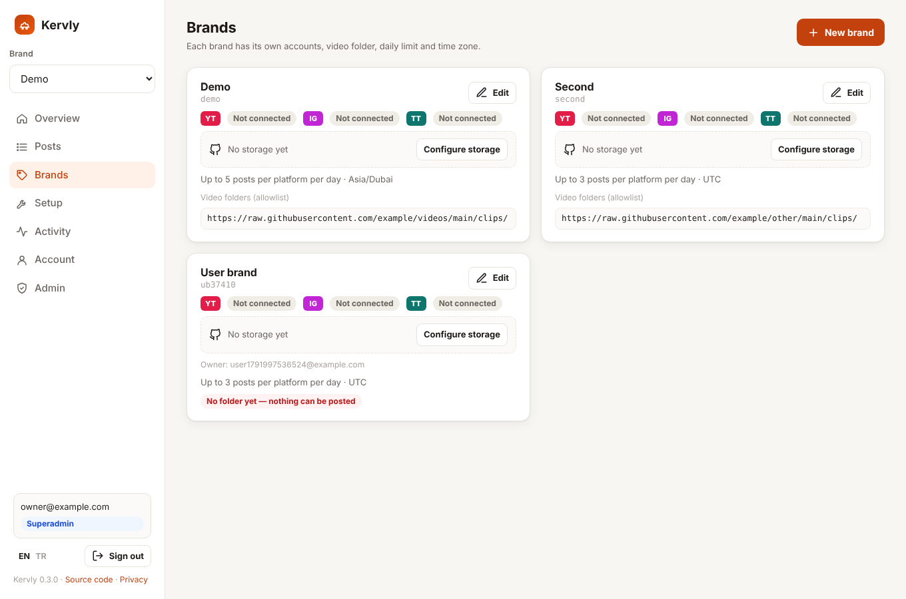
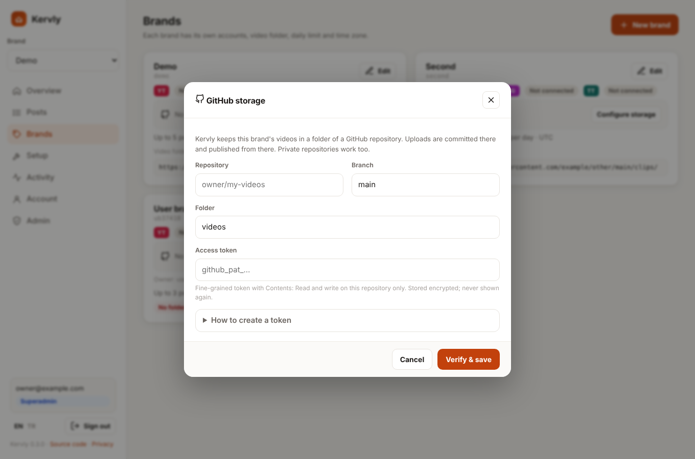
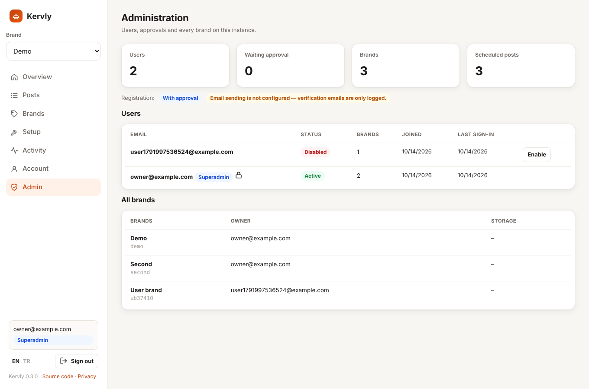
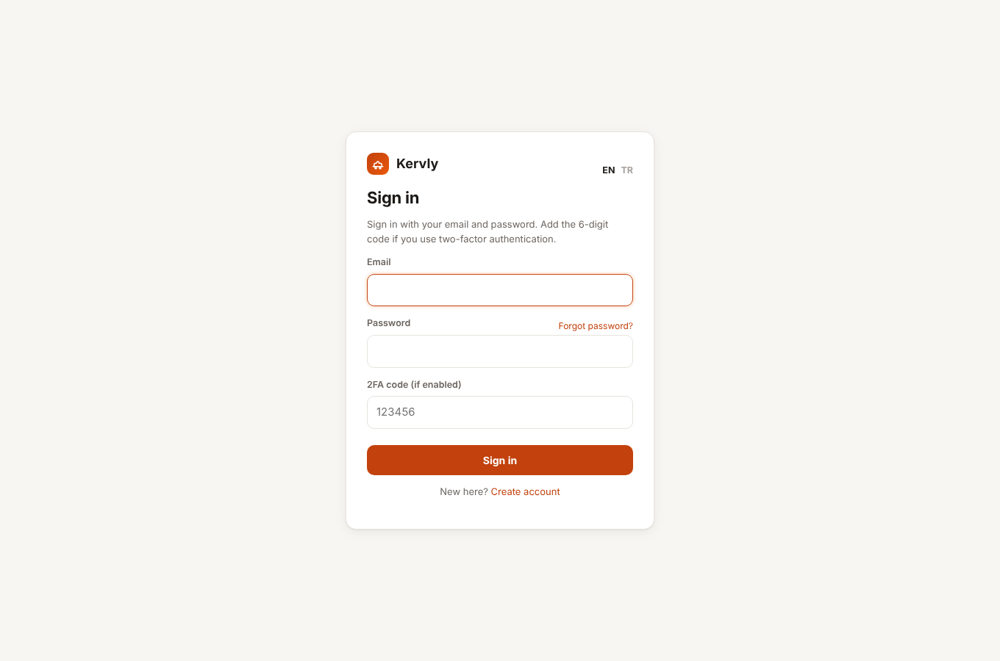
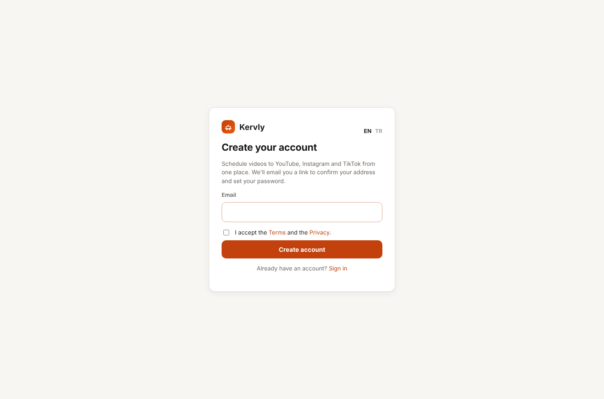
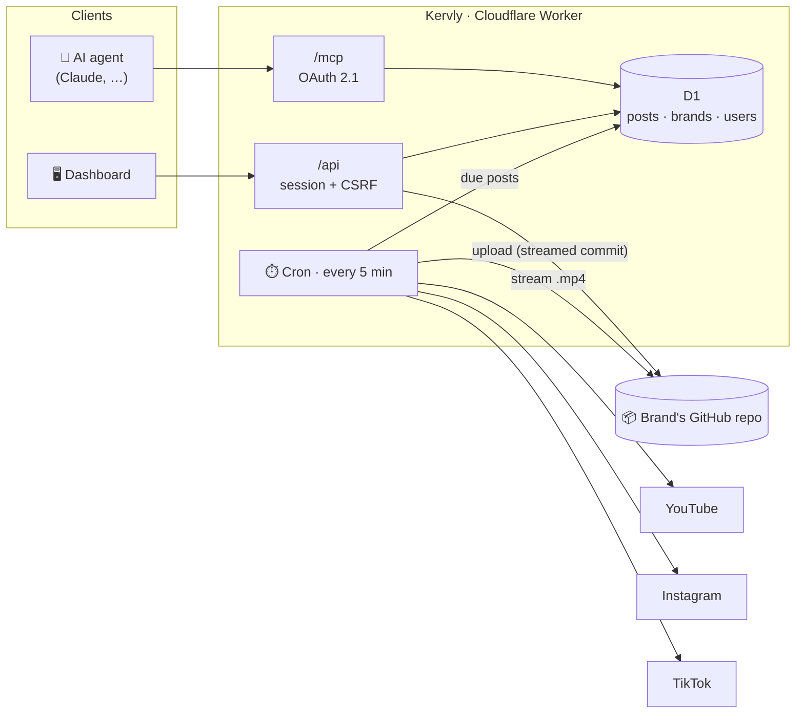

<p align="center">
  
</p>

<p align="center">
  <b>Open-source video scheduler for YouTube Shorts, Instagram Reels and TikTok — with a built-in MCP server.</b><br>
  Multi-user, multi-brand, secure by default, and free to run on Cloudflare Workers.
</p>

<p align="center">
  <a href="LICENSE"></a>
  
  
  
  
</p>

<p align="center">
  <a href="https://kervly.app"><b>Kervly Cloud</b></a> ·
  <a href="docs/SELF_HOSTING.md">Self-hosting guide</a> ·
  <a href="SECURITY.md">Security</a> ·
  <a href="README.tr.md">Türkçe</a>
</p>

---

> *Kervan* is Turkish for caravan. Kervly carries your videos to every platform, on time.

<p align="center">
  
</p>

## Why Kervly?

Paid schedulers cap your posts per month and keep your content in their cloud. Kervly is a small app **you own**:

- 🆓 **No post limits.** It talks directly to the official platform APIs and runs on Cloudflare's free tier.
- 🗂️ **Your videos stay in your GitHub repo.** Each brand plugs in its own repository (private works too) as storage.
- 🤖 **AI-native.** Claude and other agents can schedule, edit and monitor posts over MCP.
- 👥 **Built for teams and agencies.** Email sign-up, approval waitlist, per-user brands and a superadmin panel.

## Features

| | |
|---|---|
| **Brands** | Each brand has its own YouTube, Instagram and TikTok accounts, storage, daily limit, time zone and default posting times. |
| **GitHub storage** | Add your repository + fine-grained token once under Account: every brand you create gets its own folder in it (`<base>/<brand id>/`, created automatically). A brand can still use a different repository of its own. Upload videos from the dashboard (streamed straight into a commit, up to 50 MB) or pick files already in the repo. Private repositories are supported via short-lived signed links. |
| **Accounts** | Email sign-up with verification, password reset, optional TOTP 2FA, and three registration modes: `closed`, `approval` (waitlist) and `open`. |
| **Superadmin** | Sees every user and brand, approves or disables accounts, and manages their own brands like anyone else. |
| **Dashboard** | Overview with setup checklist, post list with edit / duplicate / cancel / retry, video picker with upload progress, activity log. Light & dark mode, mobile layout, English & Turkish. |
| **Calendar** | Month view per brand in the brand's time zone. Click a day to see its posts and add one; days at the daily limit are marked. The scheduler publishes every 5 minutes. |
| **Analytics** | Last 7 / 30 / 90 days: published and failed posts, success rate, per-platform split, busiest hours, posting streak and most frequent errors, plus live YouTube channel statistics (subscribers, views, per-video views / likes / comments). |
| **MCP server** | `/mcp` (Streamable HTTP + OAuth 2.1). Tools: `list_brands`, `get_calendar`, `suggest_slots`, `schedule_post`, `list_posts`, `get_post`, `update_post`, `cancel_post`, `retry_post`, `get_analytics`, `get_youtube_stats`, `connection_status`, `recent_activity`. Nothing sent over MCP is published immediately: posts go into the brand's calendar, and without `publish_at` the next free default posting time is used. Each user only sees their own brands. |
| **Publisher** | YouTube resumable uploads, Instagram Reels containers, TikTok Direct Post. Videos are streamed, never buffered. Processing is tracked; tokens are refreshed before they expire. |

## Screenshots

<table>
  <tr>
    <td width="50%"><p align="center"><sub>Posts — edit, duplicate, retry</sub></p></td>
    <td width="50%"><p align="center"><sub>Brands — accounts and storage per brand</sub></p></td>
  </tr>
  <tr>
    <td><p align="center"><sub>Connect a GitHub repository as storage</sub></p></td>
    <td><p align="center"><sub>Superadmin — users, approvals, all brands</sub></p></td>
  </tr>
  <tr>
    <td><p align="center"><sub>Sign in with optional 2FA</sub></p></td>
    <td><p align="center"><sub>Email sign-up</sub></p></td>
  </tr>
</table>

## How it works



## Security

| Layer | Measure |
|---|---|
| Sign-in | Passwords hashed with PBKDF2-SHA256. Optional TOTP 2FA for users, **mandatory** for the superadmin. Rate limits per IP, per email and per email+IP. Constant-time checks, no account enumeration. |
| Sessions | `__Host-` cookie, HttpOnly, Secure, SameSite=Lax, 8 h. Only a hash is stored. Password reset or disabling a user ends all of their sessions and MCP grants. |
| CSRF | `X-CSRF-Token` header + Origin check on every write. |
| Isolation | Every query is scoped to the signed-in user. Other users' brands, posts, storage and activity return *not found*. |
| MCP | OAuth 2.1 + PKCE (`@cloudflare/workers-oauth-provider`). Tokens are bound to the user and invalidated when their session version changes. |
| Secrets at rest | Platform tokens, storage tokens and TOTP secrets are AES-256-GCM encrypted, each bound to its owner (AAD). Never returned by any API, log or MCP tool. |
| Media | A brand only publishes `.mp4` files from its own storage folder or allowlisted prefixes. Private-repo videos are exposed to platforms only through 30-minute HMAC-signed links. |
| Least privilege | YouTube `youtube.upload` + `youtube.readonly` (channel statistics); Instagram `instagram_business_basic` + `instagram_business_content_publish`; TikTok `user.info.basic` + `video.publish`; GitHub: fine-grained token, *Contents: read & write* on one repo. |
| Reliability | Posts are claimed with conditional updates (no double posting); interrupted uploads are never retried blindly. |
| Browser | Strict nonce-based CSP, `frame-ancestors 'none'`, HSTS, nosniff, `no-store`. |
| Repository | No secrets and no personal ids in git. Deploy reads them from GitHub variables / Cloudflare secrets. CI runs gitleaks on the full history. |

Found a vulnerability? See [SECURITY.md](SECURITY.md).

## Quick start

Full guide: **[docs/SELF_HOSTING.md](docs/SELF_HOSTING.md)**. In short:

1. Create a D1 database and two KV namespaces on Cloudflare.
2. Fork this repo and set the GitHub secrets/variables (`CLOUDFLARE_API_TOKEN`, `D1_DATABASE_ID`, `SUPERADMIN_EMAIL`, …).
3. Run the **Deploy** workflow, then open `/setup` to generate your secrets.
4. Sign in, create a brand, plug in a GitHub repo and connect your platform accounts.

## Self-host or Cloud?

| | Self-hosted | [Kervly Cloud](https://kervly.app) |
|---|---|---|
| Price | Free (Cloudflare free tier) | Paid plans |
| Setup | ~30 min, your own platform apps | Sign up and connect |
| Data | Your Cloudflare account + your GitHub | Hosted by us, videos still in your GitHub |
| Code | This repository, AGPL-3.0 | Same code |

The open-source repository contains **no data, keys or configuration from Kervly Cloud**. Every instance is fully independent.

## Development

```bash
npm ci
cp .dev.vars.example .dev.vars          # then open http://localhost:8787/setup to generate values
npx wrangler d1 migrations apply DB --local
npm run dev                              # http://localhost:8787
npm run check                            # typecheck + unit tests + build
npm run e2e                              # end-to-end test against the dev server
```

Locally, emails aren't sent; verification and reset links are printed in the dev server log.
Kervly is developed by its owner only; see [CONTRIBUTING.md](CONTRIBUTING.md).

## License

[AGPL-3.0](LICENSE). You can use, modify and self-host Kervly freely. If you offer a modified version as a network
service, you must publish your changes under the same license.
