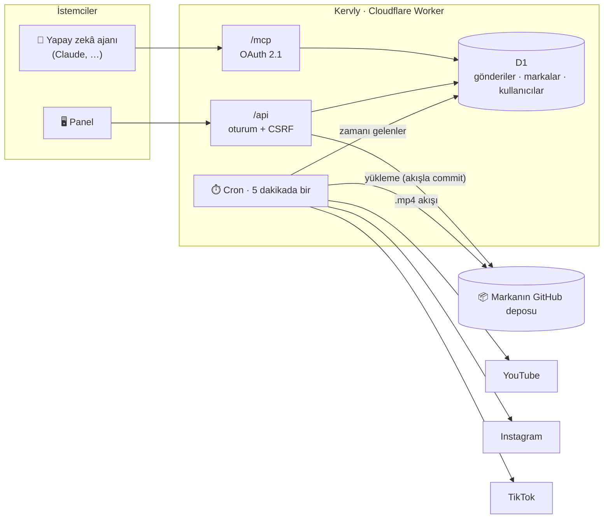

<p align="center">
  
</p>

<p align="center">
  <b>YouTube Shorts, Instagram Reels ve TikTok için açık kaynak video planlayıcı — dahili MCP sunucusuyla.</b><br>
  Çok kullanıcılı, çok markalı, varsayılan olarak güvenli ve Cloudflare Workers'ta ücretsiz çalışır.
</p>

<p align="center">
  <a href="LICENSE"></a>
  
  
  
  
</p>

<p align="center">
  <a href="https://kervly.app"><b>Kervly Cloud</b></a> ·
  <a href="docs/SELF_HOSTING.tr.md">Kurulum rehberi</a> ·
  <a href="SECURITY.md">Güvenlik</a> ·
  <a href="README.md">English</a>
</p>

---

> Videolarınızı tüm platformlara, zamanında taşıyan kervan.

<p align="center">
  
</p>

## Neden Kervly?

Ücretli planlayıcılar aylık gönderi sayısını sınırlar ve içeriğinizi kendi bulutlarında tutar. Kervly **size ait** küçük bir uygulamadır:

- 🆓 **Gönderi sınırı yok.** Platformların resmî API'leriyle doğrudan konuşur, Cloudflare'in ücretsiz planında çalışır.
- 🗂️ **Videolarınız kendi GitHub deponuzda.** Her marka kendi deposunu (gizli de olabilir) depolama olarak bağlar.
- 🤖 **Yapay zekâya hazır.** Claude ve diğer ajanlar MCP ile gönderi planlar, düzenler, takip eder.
- 👥 **Ekipler ve ajanslar için.** E-posta ile kayıt, onaylı bekleme listesi, kullanıcıya özel markalar ve süper yönetici paneli.

## Özellikler

| | |
|---|---|
| **Markalar** | Her markanın kendi YouTube, Instagram ve TikTok hesapları, depolaması, günlük limiti, saat dilimi ve varsayılan paylaşım saatleri vardır. |
| **GitHub depolama** | Hesap sayfasında repo + ince ayarlı token'ı bir kez ekleyin: oluşturduğunuz her marka bu repoda kendi klasörünü (`<ana klasör>/<marka kimliği>/`) otomatik alır. İsterseniz bir marka kendi ayrı reposunu da kullanabilir. Videoları panelden yükleyin (doğrudan bir commit'e akışla, 50 MB'a kadar) ya da depodaki dosyaları seçin. Gizli depolar kısa ömürlü imzalı bağlantılarla desteklenir. |
| **Hesaplar** | Doğrulamalı e-posta kaydı, parola sıfırlama, isteğe bağlı TOTP 2FA ve üç kayıt modu: `closed`, `approval` (bekleme listesi), `open`. |
| **Süper yönetici** | Tüm kullanıcıları ve markaları görür, hesapları onaylar veya devre dışı bırakır, kendi markalarını herkes gibi yönetir. |
| **Panel** | Kurulum listesiyle genel bakış; düzenle / kopyala / iptal / yeniden dene; yükleme ilerlemeli video seçici; etkinlik kaydı. Açık & koyu tema, mobil görünüm, Türkçe & İngilizce. |
| **Takvim** | Marka başına, markanın saat diliminde aylık görünüm. Bir güne tıklayıp gönderilerini görür ve yenisini eklersiniz; günlük limiti dolan günler işaretlenir. Zamanlayıcı 5 dakikada bir yayınlar. |
| **Analitik** | Son 7 / 30 / 90 gün: yayınlanan ve başarısız gönderiler, başarı oranı, platform dağılımı, en yoğun saatler, gün serisi ve en sık hatalar (Kervly'nin kendi kuyruğundan; platformların izlenme sayıları dahil değildir). |
| **MCP sunucusu** | `/mcp` (Streamable HTTP + OAuth 2.1). Araçlar: `list_brands`, `get_calendar`, `suggest_slots`, `schedule_post`, `list_posts`, `get_post`, `update_post`, `cancel_post`, `retry_post`, `get_analytics`, `connection_status`, `recent_activity`. MCP'den gelen hiçbir şey anında yayınlanmaz: gönderiler markanın takvimine girer, `publish_at` verilmezse bir sonraki boş varsayılan saat kullanılır. Her kullanıcı yalnızca kendi markalarını görür. |
| **Yayıncı** | YouTube resumable yükleme, Instagram Reels container, TikTok Direct Post. Videolar belleğe alınmadan akışla aktarılır; işleme durumu izlenir, tokenlar süresi dolmadan yenilenir. |

## Ekran görüntüleri

<table>
  <tr>
    <td width="50%"><p align="center"><sub>Gönderiler — düzenle, kopyala, yeniden dene</sub></p></td>
    <td width="50%"><p align="center"><sub>Markalar — markaya özel hesaplar ve depolama</sub></p></td>
  </tr>
  <tr>
    <td><p align="center"><sub>GitHub deposunu depolama olarak bağlama</sub></p></td>
    <td><p align="center"><sub>Süper yönetici — kullanıcılar, onaylar, tüm markalar</sub></p></td>
  </tr>
</table>

## Nasıl çalışır



## Güvenlik

| Katman | Önlem |
|---|---|
| Giriş | Parolalar PBKDF2-SHA256 ile özetlenir. Kullanıcılar için isteğe bağlı, süper yönetici için **zorunlu** TOTP 2FA. IP, e-posta ve e-posta+IP başına hız sınırı. Sabit zamanlı kontroller, hesap varlığı sızdırılmaz. |
| Oturumlar | `__Host-` çerez, HttpOnly, Secure, SameSite=Lax, 8 saat. Yalnızca özeti saklanır. Parola sıfırlama veya kullanıcıyı devre dışı bırakma tüm oturumlarını ve MCP izinlerini sonlandırır. |
| CSRF | Her yazma işleminde `X-CSRF-Token` başlığı + Origin kontrolü. |
| Yalıtım | Her sorgu giriş yapan kullanıcıyla sınırlıdır. Başka kullanıcıların markaları, gönderileri, depolaması ve etkinliği *bulunamadı* döner. |
| MCP | OAuth 2.1 + PKCE. Tokenlar kullanıcıya bağlıdır; oturum sürümü değişince geçersiz olur. |
| Saklanan sırlar | Platform tokenları, depolama tokenları ve TOTP sırları AES-256-GCM ile şifrelenir ve sahibine bağlanır (AAD). Hiçbir API, log veya MCP aracı bunları döndürmez. |
| Medya | Marka yalnızca kendi depolama klasöründeki veya izinli öneklerdeki `.mp4` dosyalarını yayınlar. Gizli depo videoları platformlara yalnızca 30 dakikalık HMAC imzalı bağlantılarla açılır. |
| En az yetki | YouTube `youtube.upload`; Instagram `instagram_business_basic` + `instagram_business_content_publish`; TikTok `user.info.basic` + `video.publish`; GitHub: tek depoda *Contents: read & write* yetkili ince ayarlı token. |
| Depo | Git'te hiçbir sır ve kişisel kimlik yok. Dağıtım bunları GitHub değişkenlerinden / Cloudflare sırlarından okur. CI tüm geçmişi gitleaks ile tarar. |

## Hızlı başlangıç

Ayrıntılı rehber: **[docs/SELF_HOSTING.tr.md](docs/SELF_HOSTING.tr.md)**. Kısaca:

1. Cloudflare'de bir D1 veritabanı ve iki KV alanı oluşturun.
2. Depoyu fork'layın, GitHub sırlarını/değişkenlerini girin (`CLOUDFLARE_API_TOKEN`, `D1_DATABASE_ID`, `SUPERADMIN_EMAIL`, …).
3. **Deploy** iş akışını çalıştırın, sırlarınızı üretmek için `/setup` sayfasını açın.
4. Giriş yapın, marka oluşturun, bir GitHub deposu bağlayın ve platform hesaplarınızı bağlayın.

## Kendin kur mu, Cloud mu?

| | Kendi sunucunda | [Kervly Cloud](https://kervly.app) |
|---|---|---|
| Fiyat | Ücretsiz (Cloudflare ücretsiz plan) | Ücretli planlar |
| Kurulum | ~30 dk, kendi platform uygulamalarınız | Kaydol ve bağla |
| Veri | Sizin Cloudflare hesabınız + GitHub'ınız | Bizde barındırılır, videolar yine sizin GitHub'ınızda |
| Kod | Bu depo, AGPL-3.0 | Aynı kod |

Açık kaynak depo, Kervly Cloud'a ait **hiçbir veri, anahtar veya yapılandırma içermez**. Her kurulum tamamen bağımsızdır.

## Geliştirme

```bash
npm ci
cp .dev.vars.example .dev.vars          # sonra değerleri üretmek için http://localhost:8787/setup
npx wrangler d1 migrations apply DB --local
npm run dev                              # http://localhost:8787
npm run check                            # tip kontrolü + birim testleri + derleme
npm run e2e                              # geliştirme sunucusuna karşı uçtan uca test
```

Yerelde e-posta gönderilmez; doğrulama ve sıfırlama bağlantıları sunucu loguna yazılır.

## Lisans

[AGPL-3.0](LICENSE). Kervly'yi özgürce kullanabilir, değiştirebilir ve kendi sunucunuzda çalıştırabilirsiniz. Değiştirilmiş
bir sürümü ağ hizmeti olarak sunarsanız değişikliklerinizi aynı lisansla yayınlamanız gerekir.
